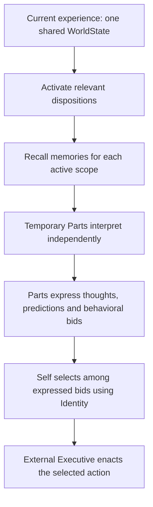
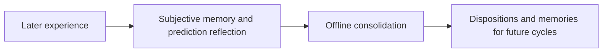

<p align="center">
  
</p>

# Prismatic Architecture

### A Cognitive Architecture for Continual Learning and Adaptive Intelligence

**Developed by Taylor Burke | Apache License 2.0**

An open-source research project exploring how autonomous intelligence can emerge from interacting cognitive parts, experience-driven dispositions, memory, and prediction-based learning. Persistent dispositions recruit temporary perspectives that interpret the same situation, recall subjective memories, make predictions, and propose behavior. A world-blind Self selects among their expressed proposals using Identity; experience and offline consolidation can change what the Agent attends to and remembers without retraining the underlying language model.

**Try a concrete example:** run `npm run demo` after installation, or compare the supplier-learning experiment with its matched control: claims → contrary inspections → consolidation → familiar and unfamiliar source retests. Inspect predictions, recalled memories, disposition versions, and selected behavior—not dialogue alone.

[Architecture](#architecture-overview) · [Experiments and evidence](#experiments-benchmarks-and-results) · [Quick start](#installation-and-quick-start) · [Collaborate](#contributing-authorship-citation-and-licensing)

## Introduction and research objective

**Can an AI agent develop adaptable behavior through persistent dispositions, transient cognitive parts, memory, and experience-based learning without retraining its underlying language model?**

A prompt-and-tool loop can produce capable behavior, but raises a further research question: how should experience change the organization of future attention, interpretation, and choice? Prismatic Architecture makes those relationships explicit and inspectable. Its experimental contribution is the connection between learned relevance, reconstructed perspectives, competing proposals, later prediction evidence, and conservative structural learning.

> Adaptive intelligence can be supported by a persistent, evolving organization of dispositions and memories, which recruits temporary cognitive processes to interpret situations, generate competing behavioral proposals, and learn from predictions.

This is the central hypothesis, not an established result. The project is an independently developed experimental cognitive architecture, implemented in TypeScript with durable Agent state and a browser research inspector. It does not establish a model of human psychology or a performance advantage over conventional agents.

## Key features and research hypotheses

| Status | Capability | What researchers can examine |
| --- | --- | --- |
| Implemented | Contextual disposition activation and soft associations | Independent relevance scores; several conflicting scopes can activate together. Activation is separate from compute-budget admission and action authority. |
| Implemented | Memory-driven transient Parts | Chronological subjective recall and independent perspective construction against one immutable snapshot. Memories may disagree. |
| Implemented | Competing bids and world-blind Self | Identity-guided selection and bounded inquiry over expressed proposals, without direct world access. |
| Implemented | Prediction verification and temporary relevance | Later factual checks, attributed outcome reflection, gap-origin hypotheses, and versioned scaffolds investigated through ordinary later cognition. |
| Implemented | Online experience and offline consolidation | Versioned subjective episodes, evidence attachment, and conservative disposition development with source lineage. No model-weight updates. |
| Implemented, experimental | Affect focus, dream experiences, and selected tool execution | Separate Self affect/bid passes, isolated developed-Agent continuations, and opt-in external execution with validated contracts. |
| Research hypothesis | Durable adaptation and bounded transfer | Whether these mechanisms improve later discrimination, forecasting, and behavior rather than merely accumulating records. |
| Planned evaluation | Broad comparative benchmarks and mechanism ablations | Adaptation speed, prediction calibration, long-term retention, cross-environment transfer, and benefit per unit of computation. |

“Implemented” describes software availability. It does not mean the corresponding cognitive benefit has been demonstrated. [Implementation audits](docs/development/) document verification and outstanding empirical questions.

## Live demonstration and examples

### A source says one thing; experience supplies another

The registered **Recorded learning, consolidation and transfer** experiment supplies ordinary experiences to a fresh Agent:

| Stage | External experience | Evidence to inspect |
| --- | --- | --- |
| Baseline | Rowan says an unopened crate contains a red token. | Any expressed prediction, proposed check, and selected behavior. |
| Experience | Two separate inspections find blue tokens, contrary to Rowan’s claims. | Later prediction checks and newly formed subjective memories. |
| Consolidation | Ordinary offline sleep processes the recorded experience. | Disposition and memory versions, decisions, and preserved source lineage. |
| Familiar retest | Rowan makes another unverified crate claim. | What is recalled, expected, and proposed compared with baseline. |
| Transfer and controls | Morgan is unfamiliar; Quinn has accurate observed testimony; an unrelated scene has no claims. | Bounded generalization versus unsupported global distrust. |

Run its paired **Learning comparison without contrary training** condition with the same settings. The control has matching stage counts and sleep but receives unrelated observations instead of contradictory crate evidence. A changed dialogue alone cannot establish learned disposition usefulness; unchanged behavior or absent predictions can leave the hypothesis unobserved or inconclusive.

The [runnable definitions](packages/sdk/src/observatory-simulations.ts) preserve authored starting attention, experiences, criteria, controls, and limitations. Open **Agent Operations → Dreams** for the research interface and frozen before/after evidence. The underlying experiment registry retains the name **Simulation Tests**.

For a quick software walkthrough, `npm run demo` creates **Development demo**, delivers two encounters with Bill, consolidates, and probes a related encounter with Alex. It uses deterministic mock providers and explicitly enables execution for this demo. Its traces demonstrate the pipeline, not emergent learning or therapeutic efficacy. [Demo source](packages/sdk/src/demo.ts).

## Architecture overview

<p align="center">
  
</p>

*The artwork is a metaphor for plurality and integration. Colored figures represent possible cognitive perspectives, not six fixed emotional modules. Dispositions encode learned relevance, associations, concerns, expectations, and contextual sensitivities; recruited Parts may express affect and behavioral preferences.*

The [illustration guide](docs/ILLUSTRATIONS.md) describes all seven supplied images and their suggested explanatory uses.

**Parts interpret and propose; Self enters at the end to choose.** Persistent dispositions determine which perspectives become relevant, and remembered experience informs how those perspectives interpret the situation.



Self enters after Parts have produced their contributions. It receives their expressed products and Identity, never the raw WorldState or recalled memories. Its bounded inquiry can ask Parts to clarify or revise before final selection; it does not supply their initial interpretation.

**Experience changes what future Parts can draw on.** Learning is a separate feedback path, not another decision-maker inside the selection sequence:



Online cognition can record subjective memories and propose temporary relevance for later investigation. Durable disposition development waits for conservative offline review of recorded usefulness; prediction correctness alone is insufficient. These diagrams explain responsibilities, not every runtime branch. All active Parts receive the same immutable snapshot. Primitives do not participate in current online cognition. When no disposition activates, a fallback Part named `self` forms around Identity; it remains distinct from the selecting **Self**.

Self selects; the Executive enacts. The Executive is **disabled by default**: ordinary cognition can record choices without external execution. Enable it explicitly in **Executive → Runtime** when the experiment requires enactment. Simulation owns external truth and supplies experiences; Agent cognition supplies psychological meaning.

Read the [canonical flow](docs/architecture/CANONICAL_AGENT_FLOW.md), [system overview](docs/architecture/SYSTEM_OVERVIEW.md), and [access invariants](docs/architecture/INVARIANTS.md). Architecture documents retain historical stages; current online responsibilities are established by [ADR 0133](docs/architecture/decisions/0133-parallel-assembled-part-cognition.md), [0136](docs/architecture/decisions/0136-experienced-and-prospective-worldstate.md), [0138](docs/architecture/decisions/0138-prediction-led-relevance-scaffolds.md), [0139](docs/architecture/decisions/0139-soft-disposition-activation-associations.md), and [0157](docs/architecture/decisions/0157-two-pass-self-and-affect-exploration.md).

## Core cognitive mechanisms

| Mechanism | Inputs, outputs, and responsibility |
| --- | --- |
| Dispositions | Persistent contextual relevance definitions guide which experiences and subjective memories matter; they are broader than emotion labels or personas. |
| Activation and coactivation | The shared snapshot produces independent graded scores. Soft contributing/inhibiting associations inform a bounded second judgment using frozen direct scores. No winner-take-all activation or recursive same-cycle propagation. |
| Memory retrieval | Each active scope selects relevant subjective episodes; code orders them chronologically. Recall preserves interpretation and provenance rather than declaring an objective autobiography. |
| Transient Parts | Scope continuity and recalled memories support formation → reflection → gist → cognition in one independent generation per Part. Retired instances and versions remain inspectable. |
| Cognitive bids | Parts express interpretations and candidate behavior, possibly with local strategies. Proposals do not authorize execution. |
| Predictions | A Part can have at most one unresolved prediction; separate bounded coverage can propose gap-origin hypotheses. Later factual evidence checks the preserved capsule, with revisions and outcome history retained. |
| Temporary relevance | Predictions may propose zero or more versioned scaffolds. They become eligible in later cycles and undergo ordinary activation, recall, and Part construction. |
| Consolidation | Selected episodes and investigation/usefulness traces support conservative offline refinement and institutionalization. Ended investigations and repeated recorded usefulness matter; a correct guess alone does not justify durable structure. |
| Self and Identity | Self receives Identity, expressed Part products, forecasts, bids, and mediated inquiry/stance history. Identity is persistent self-definition; Self holds selection authority. |
| Executive | Immutable selected contracts pass to external execution under current permissions and budgets. Compact factual feedback returns through later WorldState; operational code does not rewrite psychology. |

**Why world-blind Self?** The separation makes choice depend on what the active perspectives actually express. Self can ask Parts for more information, but cannot bypass them by reading raw WorldState, memories, private Part state, or researcher audit history. This makes mediated interpretation and internal disagreement observable experimental variables. Whether that boundary improves behavior is an empirical question, and incomplete or misleading contributions remain a limitation.

See [theory](docs/theory/README.md), [prediction development](docs/development/PREDICTION_SCAFFOLD_THREAD_AUDIT.md), and [Executive status](docs/development/EXECUTIVE_CURRENT_STATUS.md) for details.

## Installation and quick start

Requires **Node.js 24 or later** and npm. From a checkout of this repository:

```sh
npm install
npm run demo
npm run dev
```

The single example command is **`npm run demo`**. It requires no API keys or paid calls and persists its generated Agent. Open **http://127.0.0.1:3000**, select **Development demo**, and inspect its cycles, Parts, predictions, memories, and sleep history. CLI and server use the same default SQLite database, `workspace/agents/local.sqlite`. `PRISM_DB` selects another file; `PORT` changes the server port. The researcher interface binds to loopback.

### Model configuration

[`.env.example`](.env.example) is the sample configuration. Default `PRISM_PROVIDER=mock` and `PRISM_DECISIONS=mock` support fixture exploration. The demo always uses mocks, even when live providers are configured.

```sh
cp .env.example .env
```

For configured-model research, supply credentials in `.env` or environment variables and select the providers/models in the file or **Agent Settings**. For example, `PRISM_PROVIDER=openai` with `PRISM_DECISIONS=jev` requires `OPENAI_API_KEY` and `JEV_API_KEY`. Local Ollama configuration is also described in the sample. Credentials stay server-side; `.env` is ignored. Missing credentials and provider failures are explicit, with no silent mock fallback. Configured runs and optional model assessments may incur costs.

Useful commands:

```sh
npm run cli -- agent list
npm run cli -- chat AGENT_ID "I feel uncertain."
npm run cli -- sleep run AGENT_ID
```

Replace `AGENT_ID` with a saved ID. Ordinary new Agents retain the default disconnected Executive. Inspect [CLI responsibilities](apps/cli/README.md) and [provider configuration](packages/providers/README.md) for further setup.

## Experiments, benchmarks, and results

The shared [Simulation Tests registry](packages/sdk/src/simulation-tests.ts) supplies sourced hypotheses, explicit initial conditions, ordinary experiences, controls, observable criteria, and limitations. Experiments exercise the normal Agent pipeline. Fixtures must not force a learned conclusion and present it as discovery.

| Runnable experiment | Hypothesis and comparison | Observable evidence | Current evidence status |
| --- | --- | --- | --- |
| [Recorded learning and transfer](packages/sdk/src/observatory-simulations.ts) | Contrary source evidence versus matched no-training control, with sleep and novel-source probes. | Baseline/retest forecasts, recall, subjective versions, selected behavior, and bounded generalization. | Harness and inspection verified; adaptation/transfer require repeated configured-model observations. |
| [Context carryover](packages/sdk/src/observatory-simulations.ts) | Prior live conversation versus fresh-scene control at an archived greeting and later live question. | Independent scope scores, concern continuity, prediction alignment, and actual emitted behavior. | Runnable matched controls; distinguish useful unresolved concern from inappropriate carryover. |
| [Prediction-led scaffolds](packages/sdk/src/prediction-scaffold-simulations.ts) | Blank bootstrap, competing explanations, failed expectations, recurring people, and device continuity with controls. | Hypothesis origin, later-cycle participation, closure, preserved memories, and institutionalization lineage. | Deterministic lifecycle/access checks passed; configured discovery remains an empirical question. |
| [Affect exploration](packages/sdk/src/affect-simulations.ts) | Competing lenses, disconfirmation, focus lifetime, generalization, and resolution controls. | Explicit proposals, selected focus, bid revision, period history, and contrary evidence. | Integrated runtime and sourced tests; semantic benefit and calibration remain unestablished. |

### Reproduce and compare

1. Start the server and open **Agent Operations → Dreams → New dream**. Set **Experience mode** to **Research test · fresh starting conditions**, choose the registered hypothesis, and inspect its protocol. This differs from **Dream · developed Agent base**, which preserves an isolated continuation by default.
2. Use **fixture** mode first to verify the workflow. Use **configured** mode with the selected Agent's model/prompt settings for cognitive observations. Record Executive enablement and grants where required; developed-Agent dreams require it disconnected.
3. Run both members of a matched comparison with identical model, prompt, and runtime settings. Repeat independent trials; record completed, failed, and inconclusive counts separately. There is no scientifically established trial count or pooled success rate claimed here.
4. Inspect frozen stage evidence and before/after state in the research views. Preserve run/configuration provenance, criteria, exact citations, settings, and model-assessment versions. Use Comparisons to assess differences and alternatives.

**What the evidence supports today:** deterministic tests establish workflow, validation, persistence, and access boundaries. They do not establish adaptation speed, prediction accuracy, durable memory benefit, transfer, or superiority over another architecture. The [scaffold audit](docs/development/PREDICTION_SCAFFOLD_THREAD_AUDIT.md), [affect audit](docs/development/SELF_AFFECT_THREAD_AUDIT.md), and [Observatory audit](docs/development/SIMULATION_ANALYTICS_THREAD_AUDIT.md) record verification and limits. A model-based assessment is a researcher judgment with cited evidence, not ground truth or Agent cognition. Missing predictions or prerequisites remain inconclusive; infrastructure failure is recorded separately.

Broad baselines, coactivation/recall/consolidation ablations, retention horizons, and cost-normalized benchmarks remain evaluation work. Existing tests are not a published benchmark-results dataset. Historical experiment outlines under [experiments](experiments/README.md) should be read alongside current ADRs.

Software checks, using mocks or transport stubs without paid requests:

```sh
npm test
npm run typecheck
npm run lint
npm run build
```

Browser checks use local Chrome when available; `CHROME_BIN` selects another executable. `npm run smoke:live` explicitly performs paid validation in a temporary database.

## Related research and design rationale

Prismatic Architecture studies a particular composition of mechanisms, rather than claiming to invent memory retrieval, multiple perspectives, or learning from feedback.

- [Minsky's Society of Mind](https://www.media.mit.edu/groups/society-of-mind/archived-projects/) provides a conceptual comparison for intelligence arising from interacting processes. Here, Parts are bounded perspectives within one Agent, with one mediated locus of selection authority.
- [Generative Agents](https://arxiv.org/abs/2304.03442) combines stored experience, retrieval, and reflection. Prismatic makes disposition-scoped subjective interpretation and world-blind selection explicit.
- [Reflexion](https://arxiv.org/abs/2303.11366) studies language-based feedback without model-weight updates. Prismatic connects later prediction evidence to temporary relevance and conservative offline organization.

Parts-based cognition, schema-like contextual sensitivity, and predictive accounts are useful conceptual comparisons, not established equivalences to psychological theories. The project's [theory documents](docs/theory/README.md) and [decision records](docs/architecture/decisions/) explain its own meanings and tradeoffs. Comparative evaluations are needed before claiming novelty in effect or performance.

## Roadmap and known limitations

- **Empirical coverage:** repeated configured-model trials, meaningful ablations, external baselines, cross-thread durability, and compute/cost measurements remain priorities. Same-thread history and pretrained knowledge can confound apparent learning.
- **Activation:** soft associations are implemented; automatic associative learning and candidate-composition robustness are not established by that implementation.
- **Memory and consolidation:** versioning and conservative development exist; long-term retention, compression quality, and usefulness calibration need evaluation. Optional [disposition-scoped synthesis](docs/architecture/decisions/0160-disposition-memory-synthesis.md) preserves source lineage and separately gates retrieval replacement.
- **Affect:** the two-pass Self workflow is implemented; meaningful focus, calibration, and durable behavioral benefit remain research questions.
- **Executive and procedural learning:** MCP integration, selected tool contracts, guidance/checkpoint review, and versioned exact/conditional procedures exist. General planning/recovery, broader runtime portability, and semantic skill transfer remain incomplete. See [current status](docs/development/EXECUTIVE_CURRENT_STATUS.md).
- **Interpretation:** Parts can be biased or mistaken, and Self only sees mediated products. Simulation results do not validate human psychology. [Open questions](docs/architecture/OPEN_QUESTIONS.md) preserve unsettled mechanisms.

## Contributing, authorship, citation, and licensing

Contributions are welcome through [issues](https://github.com/rolyataylor2/PrismAgenticArchitecture/issues) and pull requests: reproducible failures, experiment designs, negative results, ablations, model/provider comparisons, documentation, and focused code changes. Include starting conditions, source revision, model/prompt/settings, procedure, control, trial counts, evidence, and limitations when reporting experiments. Keep credentials and generated private state out of contributions.

Read [AGENTS.md](AGENTS.md) and the relevant subsystem documentation before implementation. Preserve the separation between simulation, cognition, selection, execution, and researcher inspection. New cognitive hypotheses belong in the shared runnable experiment registry.

**Author: Taylor Burke**

**Copyright 2026 Taylor Burke**

**License: [Apache License 2.0](LICENSE)**

This project is an independently developed experimental cognitive architecture. If you use this work in academic research, publications, or derivative projects, please acknowledge the original author and cite the repository. Use [CITATION.cff](CITATION.cff) for machine-readable citation metadata; include the commit or release used for reproducibility.

Academic acknowledgment and citation are requests, not additional license conditions. The Apache License 2.0 governs applicable legal notice obligations; see [NOTICE](NOTICE). Third-party materials retain their respective licenses and notices.
